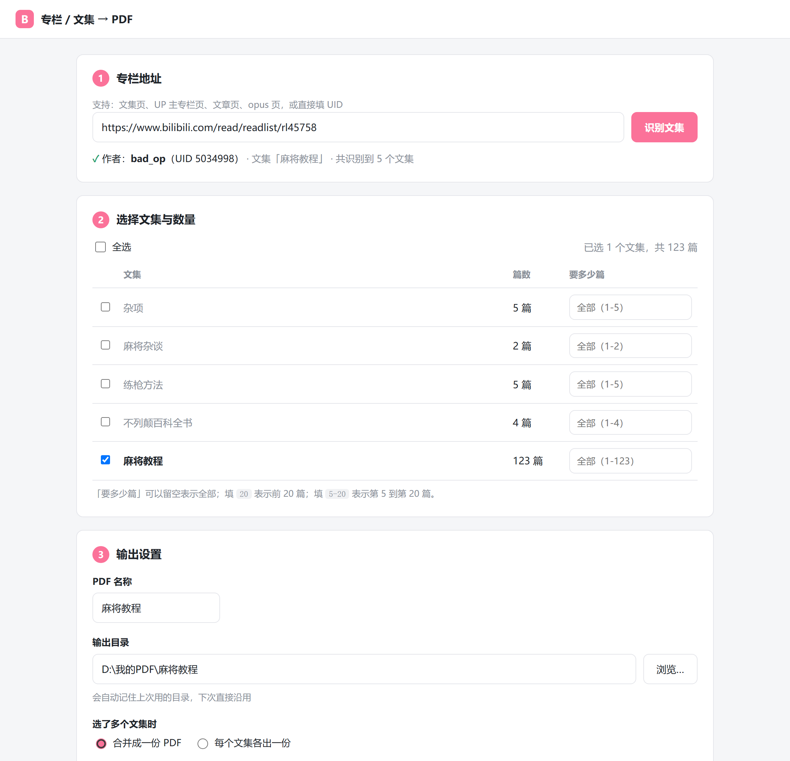

# bilibili-column-to-pdf

把哔哩哔哩专栏下的**文集**抓下来，合并成一份排版好的 PDF：封面、可点击目录、PDF 书签、页脚页码，配图全部本地化嵌入。

**下载解压 → 双击 `启动.cmd` → 在网页里点几下 → 得到 PDF。**
不需要预先安装 Node、不需要预先安装浏览器、不需要预先登录 B 站。



---

## ✨ 特性

- **免安装**：首次启动自动检测 Node.js（有就用系统的，没有自动下载便携版）；浏览器直接复用系统自带
- **网页界面**：本地起一个只监听 `127.0.0.1` 的服务，用浏览器操作，实时显示抓取/下载/渲染进度
- **智能识别**：粘一个地址就行 —— 文集页、UP 主专栏页、文章页、opus 页、纯 UID，都能解析出作者并列出他名下的**全部文集**
- **手动挑选**：勾选要合并的文集，每个文集还能单独选篇数（全部 / 前 N 篇 / 第 a–b 篇）
- **登录管理**：界面直接显示登录状态（头像 + 昵称 + UID），一键扫码登录，登录态本地保存，过期会提示重新登录
- **记住设置**：输出目录、PDF 名称、上次地址都会记住，下次自动填好
- **断点续抓**：抓到的每篇都进缓存，中断后重新生成会跳过已抓部分
- **两种输出**：多个文集可以合并成一份，也可以每个文集各出一份

---

## 🚀 快速开始

1. 下载本仓库（Code → Download ZIP），解压到任意位置（路径含中文也没问题）
2. 双击 **`启动.cmd`**
3. 浏览器会自动打开 <http://127.0.0.1:17321/>，没打开就手动访问
4. 第一次用建议先点右上角 **「登录 B 站」**，扫码（只需一次）
5. 粘贴专栏地址 → 选文集和篇数 → 填名称和目录 → **「开始生成 PDF」**

### 环境要求

| 项目 | 说明 |
|---|---|
| 系统 | Windows 10 / 11 |
| Node.js | **不需要预装**。启动器会依次尝试：仓库内 `runtime\node\` → 系统 Node（要求 18+）→ 自动下载便携版（约 33 MB，仅一次） |
| 浏览器 | **不需要预装**。优先用系统的 Chrome / Edge；都没有才会下载便携版 Chrome for Testing（约 190 MB）到 `runtime\chrome\` |
| 网络 | 需要（抓 B 站文章与图片；首次准备运行环境时也需要） |

程序的浏览器使用**独立配置目录**，不会影响你平时用的浏览器，也读不到你的书签、历史、密码。

---

## 🖥 界面说明

界面分四步：

```
① 专栏地址      粘贴地址 → 点「识别文集」
② 选择文集      勾选要下载的文集；「要多少篇」留空=全部，20=前 20 篇，5-20=第 5 到第 20 篇
③ 输出设置      PDF 名称、输出目录（网页内文件夹选择器，支持新建文件夹），也会记住上次的
                选了多个文集时可以「合并成一份」或「每个文集各出一份」
④ 生成          实时显示抓取/下载/渲染进度，完成后显示页数、大小、内链数、书签数
```

### 支持的输入地址

| 形态 | 例子 |
|------|------|
| 文集页 | `https://www.bilibili.com/read/readlist/rl45758` 或 `rl45758` |
| UP 主专栏页 | `https://space.bilibili.com/5034998/article` |
| 文章页 | `https://www.bilibili.com/read/cv1689316` |
| opus 页 | `https://www.bilibili.com/opus/204032021966673123` |
| 纯 UID | `5034998` |

---

## ⌨️ 命令行模式

习惯命令行或者要脚本化调用时：

```bat
启动.cmd --cli                                             :: 命令行向导
启动.cmd --login                                           :: 命令行登录
启动.cmd --cli --url <地址> --lists all --name 书名 --yes    :: 一次性执行
```

| 参数 | 说明 |
|------|------|
| `--url <地址>` | 专栏地址：文集页 / UP 主专栏页 / 文章页 / opus 页 / 纯 UID |
| `--lists <选择>` | 要合并的文集：`1,3` / `1-3` / `all`。不给则用地址指向的那个，否则全选 |
| `--range <范围>` | 每个文集取多少篇：`all`（默认）/ `20`（前 20 篇）/ `5-20`（第 5–20 篇） |
| `--name <名称>` | PDF 名称（不含 `.pdf`） |
| `--out <目录>` | 输出目录（默认：桌面） |
| `--split` | 多选文集时每个各出一份 PDF |
| `--login` | 一次性登录 B 站（强烈建议先做） |
| `--attach <端口>` | 复用已开启调试端口的浏览器（端口号或 `ws://` 地址） |
| `--headed` | 显示浏览器窗口（默认后台无窗口） |
| `--delay <毫秒>` | 两次请求间隔，默认 `700`。被风控时可加大 |
| `--no-cache` | 忽略缓存，全部重新抓取 |
| `--workdir <目录>` | 工作目录（缓存 / 浏览器配置 / 中间文件） |
| `--chrome <路径>` | 指定 Chrome/Edge 可执行文件 |
| `--yes` | 跳过最终确认 |

---

## ⚠️ 关于登录

B 站的专栏接口对**未登录**的高频请求会风控：抓几十篇之后接口就开始返回网页而不是数据，
表现是「大量篇目抓取失败」。这不是程序的 bug，**登录后即可完全避免**。

- 未登录也能用，但文集超过约 30 篇时容易中途被拦；界面会明确提示
- 抓失败的部分**都留在缓存里**，登录后重新生成会接着抓，不会从头再来

---

## 🔧 工作原理

1. **解析地址** → 得到作者 UID
2. **列出文集**：`x/article/up/lists?mid=` 拿到该 UP 主名下所有文集
3. **抓正文**：`x/article/view?id=` 取每篇的干净 HTML、字数、发布时间
4. **下载图片**：B 站图片 CDN 带 `Referer` 即可直接下
5. **组装 HTML**：封面 + 目录 + 逐篇正文（每篇 `break-before: page` 独占新页）
6. **出 PDF**：用 Chrome 的 `Page.printToPDF`，打开 PDF 书签、页脚页码、保留目录内链

### 为什么要用一个真实浏览器

`x/article/view` 接口对普通 HTTP 请求会返回 `code: -352`（风控），**即使带上完整 cookie 也一样**。
而在真实页面里用 `fetch()` 发起请求时，浏览器会自动附带指纹与签名，**未登录也能取到公开文章的全文**。
所以程序会拉起一个自己的浏览器，既用来抓数据，也用来渲染 PDF。

### 两个踩过的坑（都写进代码注释了）

- **大 PDF 的传输**：`printToPDF` 默认把整个 PDF 用一条 WebSocket 消息 base64 回传，
  图片多的文集（实测有个 48 篇的文集图片共 132 MB）会超过消息上限、连接被掐断（close code 1006）。
  必须改用 `ReturnAsStream` + `IO.read` 分块读取，且 `IO.read` **必须带 sessionId**。
- **图片限高**：很多文集正文就是整页扫描图（1794×2702），只限宽的话按 A4 正文宽缩放后高 271mm，
  而正文区只有 267mm —— 只超高一点点就会让 `break-inside: avoid` 无法满足：
  Chrome 把图整体推到下一页（上一页留大片空白），再在页边界把图切开。
  同时限 `max-height: 230mm` 才能做到「一张扫描页 = 一个 PDF 页」。

---

## 📁 目录结构

```
bilibili-column-to-pdf/
├── 启动.cmd                 双击入口（纯 ASCII，负责找/装 Node，再启动程序）
├── app/
│   ├── server.mjs           本地服务：API + SSE 进度 + 任务调度
│   ├── settings.mjs         记住输出目录、PDF 名称等
│   ├── browser_setup.mjs    找浏览器 / 必要时下载便携版
│   └── ui/                  网页界面（index.html / app.js / style.css）
├── bili2pdf.mjs             命令行模式入口
├── lib/
│   ├── cdp.mjs              Chrome 启动 / 复用 + CDP 客户端（只用 Node 内置能力）
│   ├── bili.mjs             B 站接口封装、地址解析、批量抓取与重试
│   ├── pipeline.mjs         生成管线（网页版和命令行共用同一套逻辑）
│   ├── images.mjs           图片并发下载与校验
│   ├── build.mjs            HTML 组装：封面 / 目录分组 / 正文
│   ├── render.mjs           printToPDF + PDF 体检
│   ├── util.mjs             文件名清洗、桌面路径等
│   └── ui.mjs               命令行交互问答
├── assets/print.css         打印样式
├── docs/screenshot.png      README 配图
├── runtime/                 首次运行自动下载（node/、chrome/），已在 .gitignore
└── .bili2pdf/               运行时数据（浏览器配置与登录态、文章缓存），已在 .gitignore
```

> `启动.cmd` 只有纯 ASCII 内容：批处理文件里混入非 ASCII 字节、或在文件内部切换代码页，
> 都会让 cmd.exe 按错误的代码页读取后续行并把命令吃掉。中文界面由 Node 程序自己输出。

**零第三方依赖**：整个项目只用 Node 内置能力（`node:http` / `node:child_process` / 全局 `fetch` / 全局 `WebSocket`），
没有 `package.json`，不需要 `npm install`。

---

## ❓ 常见问题

**双击后一闪而过 / 提示 `[x] Could not set up Node.js`**
自动下载 Node 失败（通常是网络问题）。到 <https://nodejs.org/> 装一个 18 以上的版本再双击即可。

**大量篇目抓不到 / 提示「返回网页而非 JSON（疑似风控拦截）」**
未登录被风控了。点右上角「登录 B 站」扫码，然后重新生成 —— 已抓到的都在缓存里，会接着往下抓。

**点了「浏览…」没反应**
现在用的是网页内的文件夹选择器，一定会显示。若看到的是系统对话框行为，按 `Ctrl+R` 刷新页面。

**提示端口被占用**
已经有一个窗口在跑了。关掉之前的命令行窗口，或换个端口：`set BILI2PDF_PORT=17322 && 启动.cmd`

**提示「文件正被其它程序占用」**
输出目录里那份 PDF 你正开着。关掉阅读器窗口后重新生成即可。

**想彻底重来**
删掉 `.bili2pdf` 文件夹（缓存、浏览器配置、设置都在里面），下次启动会重新初始化。

---

## 🤖 编码来源

**本项目全部代码由 [DeepSeek](https://www.deepseek.com/) 生成。**

需求提出、方案取舍与验收由项目发起人完成；代码实现、调试与验证由 DeepSeek 完成。
因此代码风格偏向「把踩过的坑和原因写进注释」，方便后续维护者理解为什么这么写。

---

## 📄 许可与免责

[MIT License](LICENSE)

本工具仅用于把哔哩哔哩上**公开可读**的专栏文章导出为本地 PDF，供个人学习与离线阅读。
抓取到的文章、图片版权均归**原作者及哔哩哔哩**所有。
请勿用于商业用途或大规模转载，使用本工具产生的一切后果由使用者自负。
